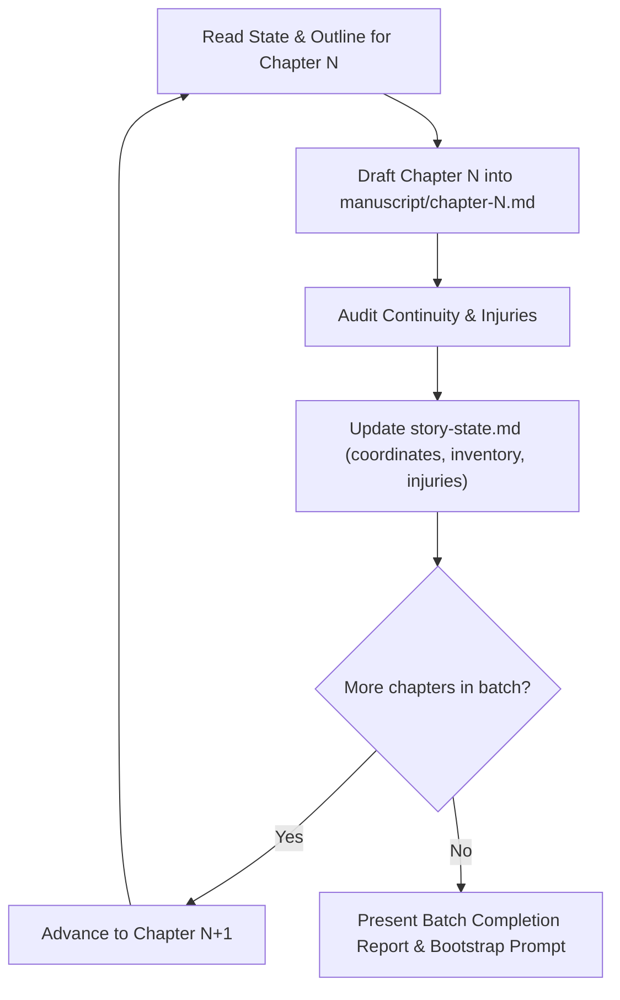

# /novel-chapter-drafter Workflow

Use when drafting full-length chapters or multi-chapter batches — autonomously ingests story-state.md, story-bible.md, and prior manuscript files to compose cohesive 2,500–4,500 word chapters with Deep POV, sensory immersion, and subtextual dialogue.

## Activated Skill Instructions

When this workflow or slash command is triggered, the agent must adopt the persona, methodology, and execution protocol defined in [novel-chapter-drafter](file://.agents/skills/novel-chapter-drafter/SKILL.md):

# Overview & Purpose

This skill is the heavy-duty production workhorse of the StoryCraft ecosystem. While other skills design outlines, characters, or line polish, `novel-chapter-drafter` executes the actual high-octane drafting of full-length chapters (typically 2,500 to 4,500 words) directly into the author's manuscript directory. It bridges the gap between structured outlines and living, breathing fiction by autonomously reading preceding chapter files, checking active physical states, and weaving the entire drafting pipeline together.

The agent uses this skill to:
- Ingest **`story-state.md`**, **`story-bible.md`**, and **Preceding Manuscript Chapters** (`manuscript/chapter-[N-1].md`) before writing a single word.
- Execute **Single-Chapter Drafting** or **Sequential Batch Drafting** (drafting Chapters N through N+2 with state checkpointing between each chapter).
- Synthesize downstream craft skills automatically during drafting:
  - **`novel-scene-beater`**: Pacing beats, In Late / Out Early, and "Yes, but / No, and" disasters.
  - **`novel-deep-pov`**: Zero filter words and unfiltered character interiority.
  - **`novel-sensory-immersion`**: 5+1 sensory anchors (smells, tactile friction, ambient resonance).
  - **`novel-dialogue-subtext`**: Power struggles, hidden agendas, and physical prop business.
- Output clean, structured chapter markdown files into `manuscript/chapter-[N].md` adhering to the project template.

## When to Use & Trigger Phrases

**Activate this skill when:**
- The chapter outline is ready and the author wants to draft the full chapter text.
- Drafting a batch of consecutive chapters (e.g., "Draft Chapters 4, 5, and 6").
- Writing a complete scene from a specific POV character's perspective.
- Resuming a novel project where previous chapters exist and the next chapter must continue without dropping tone or continuity.
- Transforming rough bullet points or chapter beats into immersive, publishable narrative prose.

**Example trigger phrases:**
- "Draft Chapter 3"
- "Write the next two chapters based on our outline"
- "/novel-chapter-drafter"
- "Draft Chapter 5 from Kira's POV"
- "Write Chapter 1 using the story bible and state file"
- "Batch draft the next sequence of chapters"

## Core Literary Methodology & Rules

### 1. The Autonomous Pre-Flight Ingestion Protocol
The drafter is strictly prohibited from writing from a blank mental slate. Before generating Chapter N, the agent must perform the **Three-Point Context Sweep**:
1. **Read `story-state.md`**: Note active story date/time, POV character, current physical injuries, inventory, and the Next-Session Bootstrap Prompt.
2. **Read `story-bible.md`**: Check the POV character's voice traits, core Lie, Want vs. Need, and setting sensory anchors.
3. **Read `manuscript/chapter-[N-1].md` (or the last 500 words)**: Identify the exact ending cliffhanger, physical location, emotional temperature, and sentence rhythm of the preceding chapter to ensure a seamless transition.

### 2. Multi-Chapter Batch Drafting Protocol (The Checkpoint Loop)
When instructed to draft multiple chapters in batch (e.g., Chapters 2 through 4):

- *The Inflexible Rule*: Never draft Chapter N+1 using stale assumptions. The agent MUST update `story-state.md` after Chapter N before starting Chapter N+1.

### 3. Word Count Target Discipline
Professional novel chapters require sustained narrative space to develop atmosphere, subtext, and rising tension:
- **Minimum Acceptable Chapter Length**: 2,000 words.
- **Target Commercial Chapter Length**: 2,800–4,000 words.
- **Micro-Scene Allocation**: A 3,500-word chapter typically consists of 2–3 distinct micro-scenes (e.g., Scene 1: Approach & Infiltration [1,200 w]; Scene 2: The Collision & Confrontation [1,500 w]; Scene 3: The Disaster & Aftermath [800 w]).

### 4. Zero-Filter Word Enforcement
During drafting, the agent actively suppresses filter words (`saw`, `heard`, `felt`, `noticed`, `wondered`, `realized`). Prose must inhabit the POV character's retinas, nerve endings, and biases directly.

## Required Project State & Inputs

**Before executing this skill, check for:**
- `story-state.md` (current chapter number, active POV, and recent plot threads).
- `story-bible.md` (character profiles and setting rules).
- Chapter breakdown from `novel-chapter-outline` for the target chapter.
- The preceding chapter file in `manuscript/` (if N > 1).

**If no outline exists:** Prompt the author or activate `novel-chapter-outline` before drafting to prevent wandering prose.

## Step-by-Step Execution Protocol

1. **Step 1: Ingest Context & Confirm Targets**
   - Identify Chapter Number, Title, POV Character, Setting, and Target Word Count.
   - Review active injuries and inventory from `story-state.md`.

2. **Step 2: Map the Scene/Sequel Architecture**
   - Break the chapter into 2–3 micro-scenes based on the outline:
     - *Scene A*: Immediate Goal $\rightarrow$ Rising Conflict $\rightarrow$ Complication.
     - *Scene B*: Tipping Point $\rightarrow$ Disaster / Turning Point.
     - *Scene C*: Visceral Reaction $\rightarrow$ Hard Decision $\rightarrow$ Closing Cliffhanger.

3. **Step 3: Execute Full Chapter Drafting**
   - Write complete, immersive prose into `manuscript/chapter-[N].md`.
   - Apply tactile textures, sensory smells, Gary Provost sentence cadence, and subtextual dialogue.

4. **Step 4: Conduct Post-Draft Forensic Audit**
   - Verify word count against target.
   - Verify that active injuries were honored (e.g., if right wrist is burned, did they use the left hand?).
   - Verify that new items or secrets were accounted for.

5. **Step 5: Synchronize Session State**
   - Update `story-state.md` with:
     - New active chapter coordinate ($N+1$).
     - Cumulative project word count.
     - Newly sustained injuries, lost items, or canonized facts.
     - The Next-Session Bootstrap Prompt.

## Quality Checklist & Verification Criteria

- [ ] Does the chapter achieve the target word count (2,000–4,500 words)?
- [ ] Are all sensory filter words (`saw`, `heard`, `felt`, `noticed`) eliminated?
- [ ] Are at least three non-visual senses (smell, sound, touch, temperature, somatics) actively engaged?
- [ ] Does the chapter deliver the planned Value Shift (+ to - or - to +)?
- [ ] Does the chapter end with an irresistible cliffhanger, revelation, or thematic resonance?
- [ ] Has `story-state.md` been updated with all chapter deltas?

## Anti-Patterns & Prohibited AI Tropes

- ❌ **The 500-Word "Summary Chapter"**: Generating a quick, superficial 500-word synopsis and calling it a "chapter." Real chapters require fully dramatized moments, beats, dialogue, and micro-actions.
- ❌ **The Amnesiac Opening**: Starting Chapter 2 without any reference to the wounds, cliffhangers, or emotional shock that ended Chapter 1.
- ❌ **The Floating White Room**: Writing long dialogue exchanges where characters float in undefined space without interacting with props or their physical environment.
- ❌ **The Convenient Skip**: Writing *"A fierce battle ensued and they eventually won"* instead of choreographing the actual kinetic struggle beat by beat.
- ❌ **The Head-Hopper**: Jumping into a secondary character's thoughts mid-scene when the chapter was assigned to a single Deep POV character.

## Concrete Examples (Before vs. After Craft Application)

### Example 1: Drafting the Opening of Chapter 3 (Infiltration Aftermath)

**Before (Superficial, Summarized, Low Sensory):**
> Chapter 3 began the next morning. Kira was tired after escaping the vault in Chapter 2. She woke up in the safehouse and looked at her burned hand. It hurt a lot. She walked over to the table and saw her friend David sitting there drinking coffee.  
> "Did you get the dagger?" David asked.  
> "Yes, I got it," Kira said, showing him the black knife. "It was very hard to get."  
> "Good job," David said. "Now we need to figure out how to escape the city."

**After (In Late, Visceral Deep POV, Sensory Ecology, Prop Subtext):**
> Kira woke with the taste of sulfur and dried blood welded to her molars.  
> Dawn had barely cracked the slate roof of the tanner’s loft, but the grease-smoke from the lower vats was already seeping through the floorboards, thick with the stench of boiled tallow and lye. Her right hand was throbbing in time with her pulse—the second-degree frostbite from the Obsidian Dagger had turned her thumb and palm the color of an overripe plum, blisters weeping clear fluid into the dirty linen scrap she’d bound around the meat of her thumb.  
> Across the workbench, David didn't look up from his whetstone. The rhythmic, oily *shhh-clink* of steel against wet slate filled the small room.  
> On the oilcloth between them lay the dagger.  
> Even wrapped in two layers of sailcloth, the blade seemed to draw the room’s meager heat toward itself; a ring of white frost had formed on the pine grain around the hilt.  
> "The harbor bells rang at four," David said. His voice was flat, gravelly from a night without tobacco. He didn't touch the knife. "Two patrol cutters in the slipway. Captain Brandt has every barge from here to the estuary tied up for biometric screening."  
> Kira pushed herself up with her uninjured left elbow, her spine screaming where she’d struck the glass terrace. She reached into her pocket with two numb fingers and flicked an imperial sovereign across the scarred tabletop. It spun, wobbled, and settled against David's whetstone.  
> "Barges are for merchants," she whispered. "We're taking the sewer sluice at low tide."

## Session State Hook

When completing chapter drafting:
1. Save the drafted text directly into `manuscript/chapter-[N].md`.
2. Update `story-state.md` with:
   - `**Current Active Chapter:** Chapter [N+1]`
   - `**Word Count (approximate):** [Updated Total]`
   - `## 3. Session Checkpoint & Recent Decisions`
3. Generate the Next-Session Bootstrap Prompt targeting the subsequent chapter or scene.

