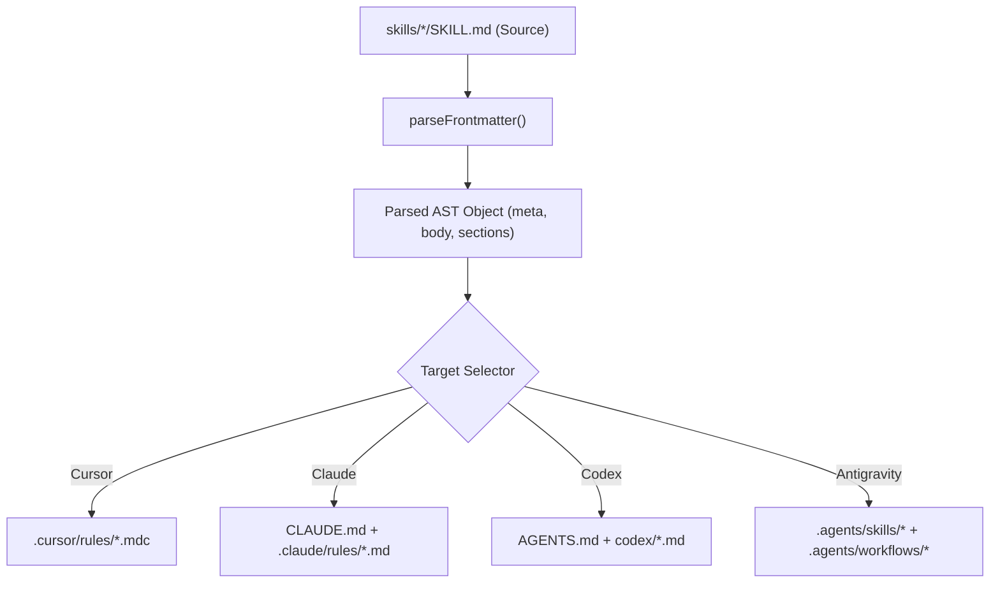

# StoryCraft Skills — System Architecture 🏛️

This document describes the architectural philosophy, data flow, compilation engine, and state management mechanisms underlying **StoryCraft Skills**.

---

## 1. Architectural Philosophy

StoryCraft Skills operates on four foundational architectural principles:

1. **Single Source of Truth (SSOT)**: Every skill is authored exactly once in standard Markdown with YAML frontmatter at `skills/<skill-name>/SKILL.md`. All platform-specific targets (`.cursor/rules/*.mdc`, `.claude/rules/*.md`, `CLAUDE.md`, `AGENTS.md`, `.agents/skills/*`, `.agents/workflows/*`) are compiled artifacts derived from this single source.
2. **Zero Runtime Dependencies**: The CLI engine (`bin/storycraft.mjs`) relies exclusively on Node.js native standard libraries (`node:fs`, `node:path`, `node:process`). It requires no compilation step, no external npm packages, and runs instantly on Linux, macOS, and Windows.
3. **Decoupled State Machine**: Narrative state (`story-state.md`) is completely separated from canonical world rules (`story-bible.md`) to optimize token window consumption during AI reasoning.
4. **Platform Agnostic & Interoperable**: By generating standards-compliant markdown rules and workflow slash commands, StoryCraft runs interchangeably across Antigravity, Cursor, Claude, OpenAI Codex, and local open-source harnesses.

---

## 2. Directory Layout & Repository Structure

```
storycraft-skills/
├── .github/
│   └── workflows/
│       └── ci.yml               # Automated test & build validation
├── bin/
│   └── storycraft.mjs           # Zero-dependency CLI & multiplatform sync engine
├── docs/
│   ├── superpowers/
│   │   ├── specs/               # Architectural & literary design specs
│   │   └── plans/               # Implementation execution plans
│   ├── QUICKSTART.md            # User-friendly guide for writers
│   └── ARCHITECTURE.md          # Internal system architecture
├── skills/                      # The 15 canonical skills (Single Source of Truth)
│   ├── novel-session-memory/
│   ├── novel-premise-hook/
│   ├── novel-worldbuilder/
│   ├── novel-character-architect/
│   ├── novel-plot-architect/
│   ├── novel-chapter-outline/
│   ├── novel-scene-beater/
│   ├── novel-sensory-immersion/
│   ├── novel-deep-pov/
│   ├── novel-dialogue-subtext/
│   ├── novel-prose-stylist/
│   ├── novel-pacing-doctor/
│   ├── novel-structural-editor/
│   ├── novel-continuity-checker/
│   └── novel-lore-bible/
├── dist/                        # Pre-compiled multiplatform exports
│   ├── .agents/                 # Antigravity skills & slash-command workflows
│   ├── .cursor/rules/           # Cursor rules (*.mdc)
│   ├── .claude/rules/           # Claude project rules + root CLAUDE.md
│   └── codex/                   # Codex markdown files + root AGENTS.md
├── templates/                   # Scaffolding templates for authors
│   ├── story-state.template.md
│   └── story-bible.template.md
├── CONTRIBUTING.md              # Community contribution guidelines
├── LICENSE                      # MIT License
├── package.json                 # CLI metadata, npm scripts & binary configuration
└── README.md                    # Rich project showcase
```

---

## 3. The Compilation Engine (`bin/storycraft.mjs`)

The CLI engine operates via a linear compilation pipeline:



### Compiler Targets:

1. **Antigravity (`syncToAntigravity`)**:
   - Emits `.agents/skills/<name>/SKILL.md` for native Antigravity skill discovery.
   - Emits `.agents/workflows/<name>.md` enabling instant chat slash-command invocation (`/<skill-name>`).
2. **Cursor (`syncToCursor`)**:
   - Emits `.cursor/rules/<name>.mdc` with frontmatter:
     ```yaml
     ---
     description: "..."
     globs:
     alwaysApply: false
     ---
     ```
3. **Claude (`syncToClaude`)**:
   - Emits individual rules in `.claude/rules/<name>.md`.
   - Generates aggregated root `CLAUDE.md` organizing the 15 skills by stage.
4. **Codex / OpenCode (`syncToCodex`)**:
   - Emits standalone rules in `dist/codex/<name>.md`.
   - Generates aggregated `AGENTS.md`.

---

## 4. State Persistence & Context Optimization Engine

Long-form fiction presents a unique challenge for LLMs: an 80,000-word novel cannot fit into an active context window without severe cognitive degradation and astronomical token costs.

StoryCraft solves this through a dual-file state persistence architecture:

```
┌────────────────────────────────────────────────────────┐
│                      AI AGENT                          │
│          (Antigravity / Cursor / Claude)               │
└───────────────▲────────────────────────▲───────────────┘
                │                        │
       Fast Active Context       Deep Static Reference
         (< 500 tokens)              (On-Demand)
                │                        │
  ┌─────────────┴────────────┐  ┌────────┴───────────────┐
  │      story-state.md      │  │     story-bible.md     │
  ├──────────────────────────┤  ├────────────────────────┤
  │ - Active Chapter & Scene │  │ - World Rules & Magic  │
  │ - Current POV Character  │  │ - Character Dossiers   │
  │ - Somatic Injuries       │  │ - Master Timeline      │
  │ - Inventory Changes      │  │ - Faction Lore         │
  │ - Next Bootstrap Prompt  │  │ - Sensory Anchors      │
  └──────────────────────────┘  └────────────────────────┘
```

### Next Session Bootstrap Mechanics
When a session concludes, `novel-session-memory` extracts the delta and formats a deterministic resume prompt:

$$\text{Bootstrap} = f(\text{NovelTitle}, \text{Chapter}, \text{Scene}, \text{POV}, \text{ImmediateDisaster}, \text{NextBeat})$$

This produces an immutable prompt that any LLM can ingest to resume drafting immediately without conversational warmup or amnesia.
